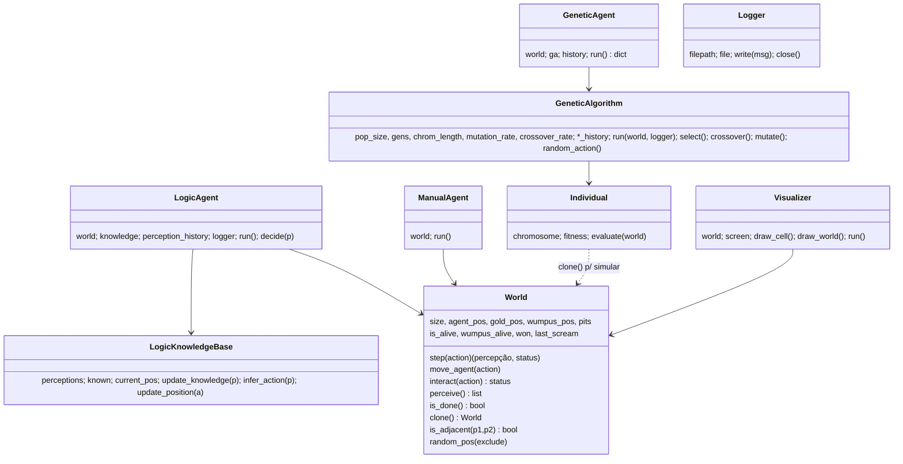

# Análise inicial do projeto (novembro de 2026)

Estado analisado: `main` @ `99e2eb4` (17/07/2025), equivalente à v1.3.0.
Análise feita em 06/11/2026 por leitura do código e do histórico git, antes de qualquer alteração. Nesse momento os
bugs não tinham sido confirmados executando o código; onde um bug é afirmado, o raciocínio está indicado.

> **Documento histórico.** O texto abaixo foi mantido como estava no dia da análise. O que aconteceu depois está em
> [reorganizacao-2026-11.md](reorganizacao-2026-11.md). Correções posteriores a este texto:
> - Os bugs 1 a 6 e o item 7 da seção 3 viraram as issues #18 a #24, todas **confirmadas executando o código** e corrigidas
>   na v1.4.0.
> - O bug 2 (fitness desatualizado após a mutação) é **menos grave** do que está descrito: na prática o melhor indivíduo
>   devolvido já estava certo, porque o elite vencia o empate. A correção foi mantida.
> - O valor "100 MB" se refere ao `.git`; depois da Fase 1 o checkout caiu para cerca de 750 KB, mas o `.git` continua
>   grande até a reescrita do histórico (Fase 6).

---

## 1. Visão geral em números

| Item | Valor |
|---|---|
| Arquivos versionados | **1.437** |
| Arquivos de código Python | **19** (~1.900 linhas) |
| Arquivos de saída (PNG/CSV/TXT/LOG) | **~1.400** (97% do repo) |
| Tamanho do `.git` | **~100 MB** (pack de 99 MB) |
| Commits | 39, 3 branches remotas, **0 tags** |
| Testes automatizados em `main` | **0** (existem 9 arquivos de teste só na branch `dev-melhorias`, nunca mergeados) |

---

## 2. Mapa de classes e módulos



**Módulos procedurais (sem classe):**

| Arquivo | Papel | Assinatura de `executar_benchmark` | Retorna |
|---|---|---|---|
| `main.py` | menu + orquestração, CSV, gráficos | — | — |
| `benchmark.py` | benchmark padrão (usado pelo `main`) | `(agente, world_size=4, num_execucoes=10)` | dict ✅ |
| `benchmark_custom.py` | CLI própria | `(agente, world_size, num_execucoes, silent=False)` | **None** ❌ |
| `benchmark_fast.py` | paralelo com joblib | `(agente, world_size, num_execucoes)` | dict, mas `dados_extra` sempre vazio ❌ |
| `benchmark_graficos.py` | gráficos na pasta atual | `(agente, world_size, num_execucoes)` | dict sem `dados_extra` |
| `benchmark_sideB.py` | constantes fixas | `(agente, world_size)` | **None** ❌ |
| `utils/graficos.py` | `gerar_graficos`, `gerar_graficos_avancados` | — | — |
| `pygad/*.py` | implementação alternativa com PyGAD | — | depende de `WumpsimAG` (**não existe no repo**) |

O contrato implícito "agente = classe com `__init__(world)` e `run()`" não está formalizado (não há classe base).

---

## 3. Inconsistências e bugs (por prioridade)

### 🔴 Críticos — afetam resultados

1. **`LogicAgent` entra em loop infinito em praticamente todo mundo.**
   `LogicKnowledgeBase` não conhece o tamanho do grid. Em (0,0) a primeira célula vizinha testada é (-1,0) → "não conhecida" → retorna `CIMA`. O `World` bloqueia o movimento (parede), mas `update_position` move a KB para (-1,0) mesmo assim. A partir daí a KB "anda" para (-2,0), (-3,0)… sempre encontrando células desconhecidas, e o `while not world.is_done()` nunca termina (não há limite de passos).
   *Evidência:* nenhum dos 36 `terminal_output.txt` versionados contém execução do agente lógico — todas as rodadas registradas são `--agentes genetico`, embora o padrão do `main` seja `logico genetico`.
   *Correção:* passar `size` para a KB, validar limites, sincronizar a posição pelo retorno do mundo e impor `max_steps`.

2. **Fitness "velho" no AG (`ga_core.py`).** `select()` faz `deepcopy` do pai (que carrega `fitness`); se não houver crossover, o filho é mutado mas **mantém o fitness do pai**. Na última geração, o laço de reavaliação só avalia quem tem `fitness is None`, então o "melhor indivíduo" retornado pode ter um fitness que não corresponde ao cromossomo. *Correção:* zerar `fitness = None` em `mutate()`/cópias, ou reavaliar todos no final.

3. **Recompensa infinita por ouro (`individual.py`).** Após `AGARRAR` no ouro, a simulação **não para** (`GANHOU` não interrompe o loop) e cada `AGARRAR` extra na mesma célula soma +100. Além disso o agente pode "vencer" e depois morrer num poço. *Correção:* `break` em `GANHOU` e marcar o ouro como coletado no `World`.

4. **Bônus de +25 por `TIRO` nunca é concedido.** A percepção é lida *depois* do tiro; se havia `FEDOR` (Wumpus adjacente e vivo), o tiro sempre mata, e o `FEDOR` some. A condição `action == 'TIRO' and 'FEDOR' in percept` é inalcançável.

5. **`main.py` só funciona com `benchmark.py`.** A opção `--benchmark` aceita qualquer arquivo, mas `benchmark_custom`/`sideB` retornam `None` (ou têm aridade diferente) e quebram em `row['vitórias']`; `benchmark_fast` lê `resultado.get("fitness")` em vez de `"dados_extra"`.

6. **Poços podem se sobrepor** (`World.__init__`): o `exclude` não inclui os poços já sorteados, então o número real de poços varia por semente.

### 🟠 Importantes — design/regras do jogo

7. `World(seed=…)` chama `random.seed()` **global** — reseta o RNG do AG e de todo o processo. Use `self.rng = random.Random(seed)`.
8. Regras divergem do Wumpus clássico: flechas ilimitadas, tiro sem direção (acerta qualquer adjacente), sem percepção `BUMP`/`GRITO` na lista de percepções, sem retorno a (0,0) para vencer. Vale documentar como decisão consciente.
9. O agente genético **otimiza sobre o mundo real clonado** (conhece Wumpus/poços via simulação), enquanto o lógico só usa percepções — a comparação entre eles no benchmark não é justa e deveria estar explícita no README/tese.
10. `GeneticAgent` padrão = 100 indivíduos × 500 gerações × 100 ações, com **reavaliação de toda a população em cada geração** (mundo determinístico → dá para cachear o fitness). `TEMPOS_MEDIOS_ESTIMADOS['genetico'] = 0.30s` está muito longe da realidade.
11. `select()` diz "torneio" no comentário, mas é seleção aleatória entre os 10 melhores (truncamento).
12. `Visualizer` (pygame) **não é usado em lugar nenhum**; README e tutorial documentam `python main.py logico --size 4 --vis`, que não existe — o `main` só tem menu interativo e não aceita agente posicional, `--size`, `--seed` nem `--vis`.
13. A opção 1 do menu usa `sys.argv[1:]`, a opção 5 usa input — os dois caminhos se misturam de forma confusa; `from benchmark import executar_benchmark` no topo é sobrescrito logo depois.
14. `Logger` é criado no `main` mas nunca passado aos agentes (eles recebem `logger = None`); o `GeneticAlgorithm.run(logger=…)` nunca recebe logger.
15. O CSV `resultados_benchmark.csv` grava o dict `dados_extra` inteiro numa coluna (repr de numpy truncado com `...`) — dado inutilizável.

### 🟡 Qualidade de código

16. Lista de ações duplicada em 4 lugares (`manual_agent`, `individual`, `ga_core`, `genetic_agent`); `AGENTES_DISPONIVEIS` e `TEMPOS_MEDIOS_ESTIMADOS` duplicados em 6 arquivos; os 5 `benchmark_*.py` são ~80% iguais.
17. Sem `__init__.py` em nenhum pacote (funciona como namespace package, mas é frágil); a pasta `pygad/` tem o mesmo nome da biblioteca `pygad` — confunde e pode mascarar imports.
18. `random_pos(exclude=[])` com default mutável; `import Individual` sem uso em `genetic_agent.py`.
19. Chaves inconsistentes: comentário da KB fala em `'safe'/'visited'`, o código usa `'seguro'/'visitado'`; chaves com acento (`"vitórias"`, `"tempo_médio"`, `"ação"`) em dicts e colunas — e nomes de arquivo com acento (`grafico_vitórias.png`) que dão problema em Windows/zip.
20. Mistura de português e inglês em identificadores (`step/move_agent` × `executar_benchmark/gerar_graficos`).
21. `requirements.txt` sem versões fixadas (pygad, numpy, scikit-learn mudam API com frequência).

---

## 4. Versionamento — o ponto principal

### 4.1 O que está errado

| Problema | Evidência | Impacto |
|---|---|---|
| **Saídas de execução versionadas** | 214 arquivos em `logs/`, 1.149 em `exemplos/`; um único commit (`18c3e7d`) adicionou 1.140 arquivos / 343 mil linhas | Repo de ~100 MB para ~2 mil linhas de código; clone lento; diffs ilegíveis |
| **Clone quebra no Windows** | Caminhos como `exemplos/exemplo_32/run_…/advanced_charts_genetico_8x8/area_empilhada_diversidade.png` estouram o limite de 260 caracteres; o clone desta análise falhou até ativar `core.longpaths` | Colaboradores no Windows recebem um checkout "vazio" e confuso |
| **`.gitignore` contraditório** | Ignora `*.log`, mas os `.png`, `.csv` e `terminal_output.txt` da mesma pasta entram | Metade de cada execução versionada, metade não |
| **Nenhuma tag** | `CHANGELOG.md` cita v1.1.0, v1.2.0, v1.3.0, mas `git tag` está vazio | Impossível voltar ao código exato de uma versão / de um resultado da tese |
| **CHANGELOG desatualizado e impreciso** | Para em v1.3.0 (14/07); PyGAD, exemplos e correções posteriores não aparecem. Cita `RELEASE_NOTES.md` (não existe), métodos `mover()`/`interagir()` (são `move_agent`/`interact`) e "executar_benchmark aceita logger opcional" (não aceita). Mistura cabeçalhos em inglês (v1.1) e português (v1.2+) | Changelog não é confiável como fonte |
| **Branch `dev-melhorias` com trabalho órfão** | Commit `652e5de` (14/07) nunca foi mergeado: traz **9 arquivos de teste**, `__init__.py` nos pacotes, `benchmark/` reorganizado, `code_citations.md` | O melhor trabalho de qualidade do projeto está fora da `main` e já diverge dela |
| **Mensagens de commit pouco informativas** | "nova leva de melhorias" (2×), "outra leva de melhorias", "Melhorias no projeto", "fix typo" | Histórico não explica o que mudou |
| **Commits misturam código e dados** | `79e3cec` "add resultados dos testes" junto com mudanças de default; `9f0ec3f` adiciona 84 arquivos de log | Revert/cherry-pick impossível sem arrastar dados |
| **Identidades duplicadas** | Mesma pessoa como `Alfa` e `Alfa Marine`; Ingrid com e-mail pessoal e noreply | Estatísticas de autoria fragmentadas (resolve com `.mailmap`) |
| **Merges direto e PRs aninhadas** | PR #9 e #10 da mesma branch `corrige_graficos`; PRs #1–#3 da mesma `dev-melhorias`; branches não apagadas após merge | Grafo confuso |
| **Resultados sem vínculo com o código** | Uma pasta `run_YYYYMMDD_HHMMSS` não registra o commit, parâmetros do AG nem versões das libs | Não dá para reproduzir um gráfico da tese |

### 4.2 Proposta

**a) Tirar dados do git**

```gitignore
# saídas de execução
logs/
results/
**/run_*/
*.pkl
```

- `exemplos/`: manter só **1 ou 2 exemplos curados**, com nomes curtos (ex.: `exemplos/ex01/`), sem `terminal_output.txt` de 1 MB. O resto vai para um **GitHub Release** (zip anexado) ou Zenodo/Drive com DOI, linkado no README.
- Para remover do histórico (opcional, reescreve histórico — combinar com todos os colaboradores antes):
  `git filter-repo --path logs --path exemplos --invert-paths` → repo cai de ~100 MB para < 1 MB.
- Se imagens grandes precisarem ficar: Git LFS.

**b) Versionamento semântico real**

- Criar tags retroativas nos commits correspondentes ao CHANGELOG (`v1.1.0`, `v1.2.0`, `v1.3.0`) e a próxima como **`v1.4.0`** (PyGAD + exemplos) ou **`v2.0.0`** se a reorganização de `dev-melhorias` entrar (muda caminhos dos benchmarks = quebra de interface).
- Uma única fonte de versão: `__version__ = "1.4.0"` em um `wumpus/__init__.py` ou em `pyproject.toml`.
- CHANGELOG no formato *Keep a Changelog*, em um idioma só, com seção `[Unreleased]` atualizada em cada PR.

**c) Fluxo de branches**

- `main` protegida (só via PR, com CI verde).
- Branches curtas por tarefa: `feat/…`, `fix/…`, `docs/…`; apagar após merge.
- **Decidir o destino de `dev-melhorias`**: rebase sobre a `main` e abrir PR (os testes valem muito), ou cherry-pick dos testes e `__init__.py` e arquivar a branch.
- Commits no padrão *Conventional Commits* (`fix(logic): limita KB ao tamanho do mundo`), um assunto por commit, código separado de dados.

**d) Reprodutibilidade dos experimentos**

Cada execução grava um `metadata.json` na pasta do run:

```json
{ "commit": "99e2eb4", "dirty": false, "version": "1.4.0",
  "args": {"agentes": ["genetico"], "sizes": [4,6,8], "execucoes": 50},
  "ga": {"pop": 100, "gens": 500, "chrom": 100, "mut": 0.02, "cx": 0.8},
  "python": "3.11.9", "libs": {"numpy": "…", "pygad": "…"} }
```

(`git rev-parse --short HEAD` + `git status --porcelain` via `subprocess`.) Fixar dependências em `requirements.txt` com `==` ou usar `pyproject.toml` + lockfile.

**e) Higiene**

- `.mailmap` unificando identidades.
- `.gitattributes`: manter `* text=auto` e adicionar `*.png binary`.
- `.github/workflows/ci.yml` rodando `pytest` + `ruff` em cada PR.
- Remover ou documentar `pygad/` (depende de `WumpsimAG`, inexistente) — renomear para `experimentos_pygad/` evita conflito com a biblioteca.

---

## 5. Melhorias de código sugeridas

1. **Estrutura de pacote**
   ```
   wumpus/
     __init__.py        (__version__)
     constants.py       (ACOES, PERCEPCOES, STATUS)
     world.py
     agents/{base.py, manual.py, logic.py, genetic.py}
     ga/{core.py, individual.py}
     bench/runner.py    (um só executar_benchmark, com --parallel)
     viz/{graficos.py, pygame_viewer.py}
   tests/
   main.py              (argparse: modo, agente, --size, --seed, --vis)
   pyproject.toml
   ```
2. **Classe base `Agent`** com `run(max_steps) -> Resultado` (dataclass com `status`, `passos`, `historico`, `dados_extra`) — todos os benchmarks passam a consumir o mesmo contrato.
3. **`World`**: RNG local, poços sem sobreposição, ouro coletável uma vez, `max_steps`, percepções `BUMP`/`GRITO`, flecha única (ou parametrizar as regras).
4. **Agente lógico** que conheça o grid, marque células seguras por inferência (sem brisa/fedor → vizinhos seguros), volte por células visitadas (BFS) e tenha limite de passos.
5. **AG**: cache de fitness, `fitness=None` ao mutar, seleção por torneio de verdade, `break` ao vencer, parâmetros vindos da CLI.
6. **Unificar os 5 benchmarks** em um runner com flags (`--parallel`, `--silent`, `--out`), salvando CSV só com colunas escalares e `dados_extra` em `.npz`/`.json` separado.
7. **Ligar o `Visualizer`** ao `main` (`--vis`) ou removê-lo junto da dependência `pygame`.
8. **Testes** (trazer os de `dev-melhorias`) cobrindo no mínimo: geração do mundo sem sobreposição, percepções, parede, término do agente lógico em N passos, fitness consistente após mutação.

---

## 6. Ordem sugerida

1. Corrigir `.gitignore` + parar de versionar `logs/` e `exemplos/` brutos (PR pequeno, ganho imediato).
2. Taguear versões existentes e atualizar o CHANGELOG.
3. Resolver `dev-melhorias` (trazer testes e `__init__.py`).
4. Corrigir bugs críticos 1–6, cada um com teste.
5. Adicionar `metadata.json` por execução + CI.
6. Refatoração estrutural (pacote, classe base, runner único) → `v2.0.0`.
7. (Opcional, combinado com a equipe) `git filter-repo` para encolher o histórico.
