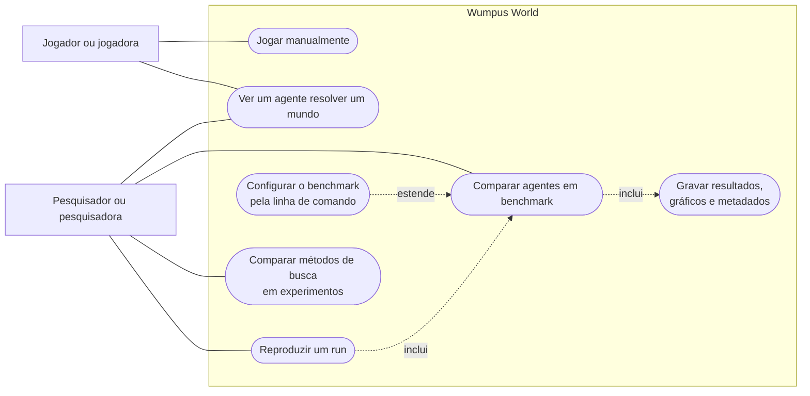

# Diagrama de caso de uso

Mostra o que cada pessoa pode fazer com o programa. Não mostra como cada função é feita internamente: isso está nos
demais diagramas. O Mermaid não tem um tipo próprio para caso de uso, então este é um fluxograma no mesmo formato visual.

Uma linha contínua liga a pessoa ao que ela faz. Em "inclui", o caso de origem sempre executa o de destino. Em "estende",
o caso de origem é uma variação opcional do caso de destino.

## Como acionar cada caso

| Caso de uso | Como acionar | Código principal |
|---|---|---|
| Jogar manualmente | `python main.py`, opção 2 | `execucao_unica`, `ManualAgent` |
| Ver um agente resolver um mundo | `python main.py`, opção 3 (lógico) ou 4 (genético) | `execucao_unica`, `LogicAgent`, `GeneticAgent` |
| Comparar agentes em benchmark | `python main.py`, opção 1 | `rodar_benchmark` |
| Configurar o benchmark pela linha de comando | Opção 5 do menu, ou `python main.py <argumentos>` seguido da opção 1 | `criar_parser`, `separar_argumentos` |
| Gravar resultados, gráficos e metadados | Automático em todo benchmark | `salvar_resultados`, `gerar_graficos`, `salvar_metadados` |
| Reproduzir um run | `python reproduzir.py logs/run_AAAAMMDD_HHMMSS` | `reproduzir.main`, `rodar_benchmark` |
| Comparar métodos de busca em experimentos | `python -m experimentos.comparar_metodos --fase <fase>` | `experimentos/comparar_metodos.py` |

O agente manual só existe na opção 2, porque pede ações pelo teclado. A busca aleatória (`aleatorio`) só roda em
benchmarks: é preciso escolhê-la com `--agentes`.
