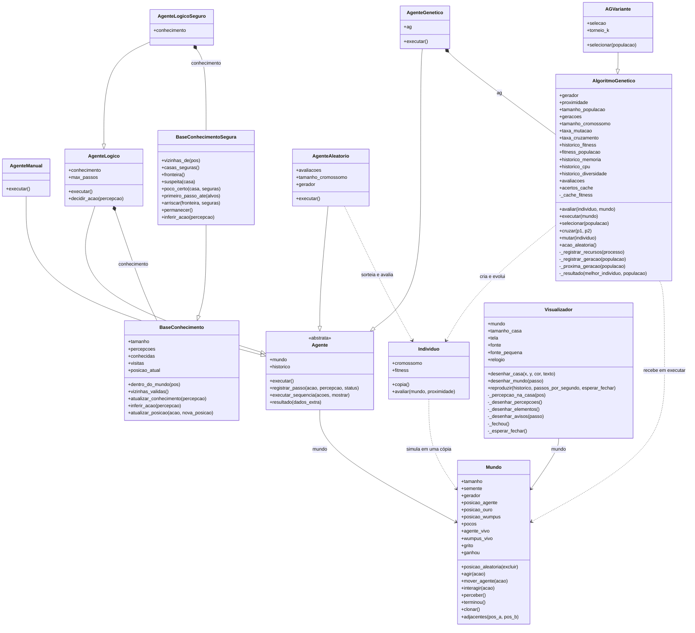

# Diagrama de classes

Mostra as 13 classes do programa, com seus atributos, métodos e relações. Ficam de fora as funções soltas de módulos como
`main.py` e `utils/`, a classe interna `SaidaDupla` de `main.py` e os testes.

## Como ler

| Seta | Significado | Exemplo |
|---|---|---|
| `-->` | A classe guarda uma referência a outra | `AgenteLogico` guarda o `Mundo` que recebe |
| `*--` | A classe cria a outra e é dona dela | `AgenteGenetico` cria seu `AlgoritmoGenetico` |
| `--\|>` | Herança | `AGVariante` herda de `AlgoritmoGenetico` |
| `..>` | A classe usa a outra sem guardá-la como parte permanente | `Individuo` usa o `Mundo` para avaliar um cromossomo |

## Onde está cada classe

| Classe | Arquivo |
|---|---|
| `Mundo` | `world/world.py` |
| `AgenteManual` | `agents/manual_agent.py` |
| `AgenteLogico` | `agents/logic_agent.py` |
| `BaseConhecimento` | `agents/logic_knowledge_base.py` |
| `Agente` | `agents/agente.py` |
| `AgenteLogicoSeguro` | `agents/logico_seguro.py` |
| `BaseConhecimentoSegura` | `agents/logico_seguro.py` |
| `AgenteGenetico` | `agents/genetic_agent.py` |
| `AgenteAleatorio` | `agents/random_search_agent.py` |
| `AlgoritmoGenetico` | `ga/ga_core.py` |
| `Individuo` | `ga/individual.py` |
| `AGVariante` | `experimentos/comparar_metodos.py` |
| `Visualizador` | `visual/visualizer.py` |

## Observações sobre o código atual

- **Todos os agentes herdam de `Agente`**, a classe base abstrata. Ela guarda o `Mundo` e o `historico`, e `executar()` devolve o
  resultado no formato único: `historico`, `passos` e `dados_extra`. A lista única `AGENTES_DISPONIVEIS`, em
  `agents/registro.py`, escolhe os agentes pelo nome em todo o programa.
- **`AgenteLogicoSeguro` herda de `AgenteLogico`** e só troca a base de conhecimento: o laço de percepção e ação é o mesmo,
  e a decisão passa a evitar poços ([investigação de 11/11/2026](../investigacao-agente-logico-2026-11.md)).
- **`AlgoritmoGenetico` e `AgenteAleatorio` avaliam com o mesmo fitness**, o método `Individuo.avaliar`.
- **`AGVariante` só é usada nos experimentos**, para trocar a seleção por torneio. Ela não entra no menu do `main.py`.
- **`Visualizador` reproduz uma partida já jogada.** O `main.py` a oferece no fim das execuções únicas, com uma cópia do mundo
  no estado inicial e o histórico do agente.
