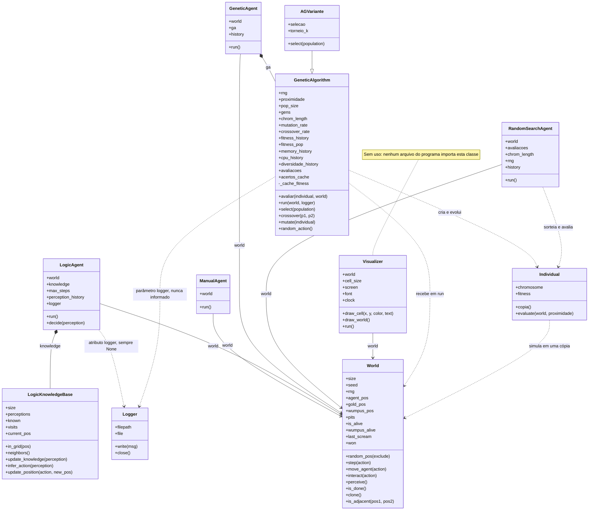

# Diagrama de classes

Mostra as 11 classes do programa, com seus atributos, métodos e relações. Ficam de fora as funções soltas de módulos como
`main.py` e `utils/`, a classe interna `DualWriter` de `main.py`, a pasta `pygad/` e os testes.

## Como ler

| Seta | Significado | Exemplo |
|---|---|---|
| `-->` | A classe guarda uma referência a outra | `LogicAgent` guarda o `World` que recebe |
| `*--` | A classe cria a outra e é dona dela | `GeneticAgent` cria seu `GeneticAlgorithm` |
| `--\|>` | Herança | `AGVariante` herda de `GeneticAlgorithm` |
| `..>` | A classe usa a outra sem guardá-la como parte permanente | `Individual` usa o `World` para avaliar um cromossomo |

## Onde está cada classe

| Classe | Arquivo |
|---|---|
| `World` | `world/world.py` |
| `ManualAgent` | `agents/manual_agent.py` |
| `LogicAgent` | `agents/logic_agent.py` |
| `LogicKnowledgeBase` | `agents/logic_knowledge_base.py` |
| `GeneticAgent` | `agents/genetic_agent.py` |
| `RandomSearchAgent` | `agents/random_search_agent.py` |
| `GeneticAlgorithm` | `ga/ga_core.py` |
| `Individual` | `ga/individual.py` |
| `AGVariante` | `experimentos/comparar_metodos.py` |
| `Logger` | `utils/logger.py` |
| `Visualizer` | `visual/visualizer.py` |

## Observações sobre o código atual

- **Não há classe base de agente.** Os quatro agentes recebem o `World` no construtor e têm um método `run()`, mas isso é
  só uma convenção. O dicionário `AGENTES_DISPONIVEIS` os escolhe pelo nome.
- **Os agentes não usam o `Logger`.** `main.py` e os benchmarks deixam `LogicAgent.logger` como `None`, e
  `GeneticAgent` chama `GeneticAlgorithm.run` sem informar um logger. Quem cria e usa o `Logger` é `rodar_benchmark`, função
  de `main.py`.
- **`GeneticAlgorithm` e `RandomSearchAgent` avaliam com o mesmo fitness**, o método `Individual.evaluate`.
- **`AGVariante` só é usada nos experimentos**, para trocar a seleção por torneio. Ela não entra no menu do `main.py`.
- Classe base, `logger` e `visual/` estão entre os pontos da Etapa 3 do [plano de boas práticas](../plano-boas-praticas.md).
