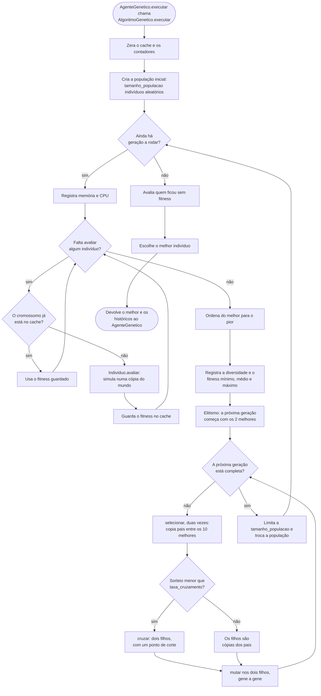

# Fluxograma do algoritmo genético

Mostra o que `AlgoritmoGenetico.executar` faz, da população inicial até o melhor indivíduo. A troca de mensagens entre as classes
está na [sequência de uma execução](sequencia-ag.md).

## Como o fitness é calculado

`Individuo.avaliar` percorre as ações do cromossomo numa cópia do mundo, somando pontos a partir de zero:

| Situação | Pontos | Efeito |
|---|---|---|
| O agente morre | −100 | A sequência para aqui |
| `AGARRAR` sobre o ouro | +100 | Soma também o custo da ação |
| `TIRO` que mata o Wumpus | +25 | Soma também o custo da ação |
| Ação de movimento | −0,5 | |
| `AGARRAR` ou `TIRO` | −1 | Custo de cada ação |
| O agente vence | | A sequência para aqui, depois de somar os pontos da ação |
| O agente termina vivo | +10 | Somado uma vez, no fim |
| Opção `proximidade` | de 0 até o peso escolhido | Somada no fim; desligada por padrão ([#31](https://github.com/ingrid-kiki/wumpus_world_modular/issues/31)) |

## Observações

- Os padrões do `AgenteGenetico` são população 100, 500 gerações, cromossomo com 100 ações, mutação 0,02 e cruzamento 0,8.
- Os 2 melhores passam para a próxima geração sem cruzamento nem mutação.
- A mutação troca cada gene com probabilidade `taxa_mutacao`. Se algum gene mudar, o fitness herdado é apagado.
- O cache só vale durante uma chamada de `executar`, porque o mundo não muda nesse período. Ele não altera o resultado, apenas
  evita simular de novo o mesmo cromossomo.
- `AGVariante`, usada nos experimentos, troca `selecionar` por seleção por torneio quando configurada para isso.
