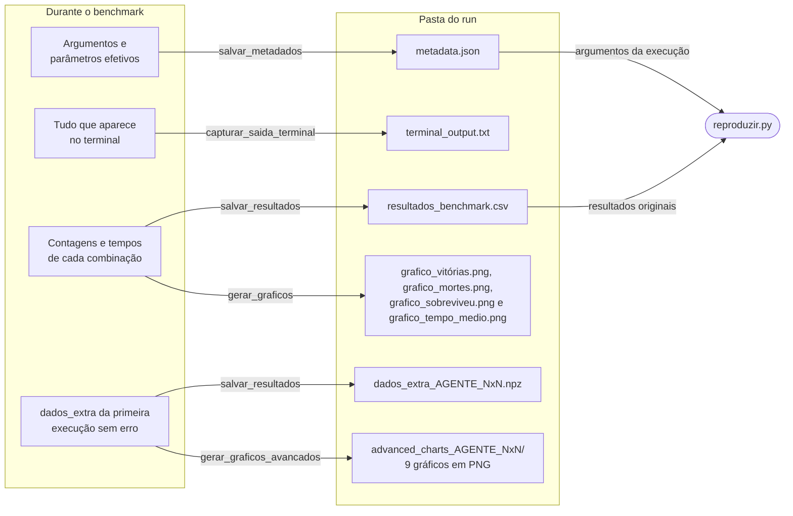

# Fluxo de dados

Mostra de onde vem cada arquivo da pasta do run e quem lê esses arquivos depois. A ordem em que eles são gravados está no
[fluxograma geral](fluxo-geral.md).

## Arquivos da pasta do run

| Arquivo | Conteúdo |
|---|---|
| `metadata.json` | Versão, data e hora, estado do git, argumentos, parâmetros do AG, regra das sementes, Python, plataforma e bibliotecas |
| `terminal_output.txt` | Saída completa do terminal, incluindo os erros |
| `resultados_benchmark.csv` | Uma linha por agente e tamanho: `agente`, `tamanho_mundo`, `vitórias`, `mortes`, `sobreviveu`, `erros`, `tempo_total` e `tempo_médio` |
| `grafico_*.png` | Barras de vitórias, mortes e sobrevivência, e tempo médio |
| `dados_extra_AGENTE_NxN.npz` | Os mesmos dados usados nos gráficos avançados |
| `advanced_charts_AGENTE_NxN/` | Os 9 gráficos avançados |

## De onde vem cada gráfico avançado

| Gráfico | Dado em `dados_extra` |
|---|---|
| `memoria_cpu.png` | `memoria` e `cpu` |
| `evolucao_fitness.png` | `fitness`, a média por geração |
| `convergencia_populacao.png` | `fitness_pop` |
| `curva_convergencia_std.png` | `fitness_pop` |
| `violin_fitness.png` | `fitness_pop` |
| `ecdf_fitness_final.png` | `fitness_final` |
| `heatmap_diversidade.png` | `diversidade_vars` |
| `area_empilhada_diversidade.png` | `diversidade_vars` |
| `pca_populacao_final.png` | `pop_final` |

## Observações

- Hoje só o agente genético devolve `dados_extra`, então o `.npz` e os gráficos avançados só existem para ele.
- Os dados de `dados_extra` vêm de uma única execução ([#29](https://github.com/ingrid-kiki/wumpus_world_modular/issues/29)).
- Os gráficos são feitos a partir dos dados em memória. Nenhuma parte do programa lê o `.npz` depois de gravá-lo: ele fica disponível
  para análises posteriores.
- `reproduzir.py` compara agente, tamanho, vitórias, mortes, sobrevivência e erros. Tempos não entram na comparação, porque variam de
  máquina para máquina.
- `experimentos/comparar_metodos.py` tem saída própria, em `logs/exp31_<fase>_AAAAMMDD_HHMMSS/`: `tentativas.csv`, `resumo.csv`,
  `comparacoes.csv` e `metadata.json`.
- A pasta `logs/` não vai para o git. Para compartilhar um run, veja a seção "Resultados de execução" do
  [CONTRIBUTING](../../CONTRIBUTING.md).
