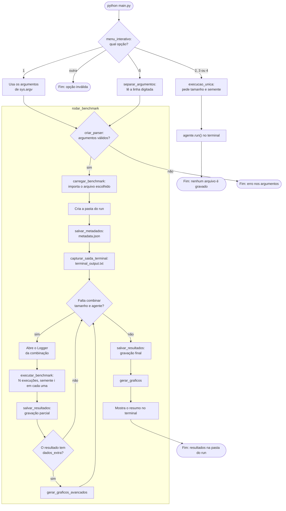

# Fluxograma geral

Mostra o caminho do menu do `main.py` até os resultados na pasta do run. O que acontece dentro de cada agente e de cada
benchmark está nos diagramas de sequência e no fluxograma do algoritmo genético.

## Observações

- A pasta do run é `logs/run_AAAAMMDD_HHMMSS/`, ou a indicada em `--saida`.
- `metadata.json` é gravado antes das execuções. Se algo falhar, o registro do que foi pedido continua lá.
- A gravação parcial acontece depois de cada combinação de tamanho e agente, então uma queda perde no máximo a combinação
  em andamento.
- Se `agente.run()` lançar um erro durante o benchmark, `executar_uma` o registra na coluna `erros` e o benchmark continua
  na execução seguinte.
- `carregar_benchmark` usa `benchmark.py` por padrão. A opção `--benchmark` escolhe outro arquivo, como
  `benchmark_fast.py`, `benchmark_custom.py`, `benchmark_graficos.py` ou `benchmark_sideB.py`.
- `reproduzir.py` chama o mesmo `rodar_benchmark` com os argumentos guardados no `metadata.json`, e depois compara os
  resultados com os originais.
- `experimentos/comparar_metodos.py` não passa por este fluxo: tem linha de comando própria e grava em
  `logs/exp31_<fase>_AAAAMMDD_HHMMSS/`.
