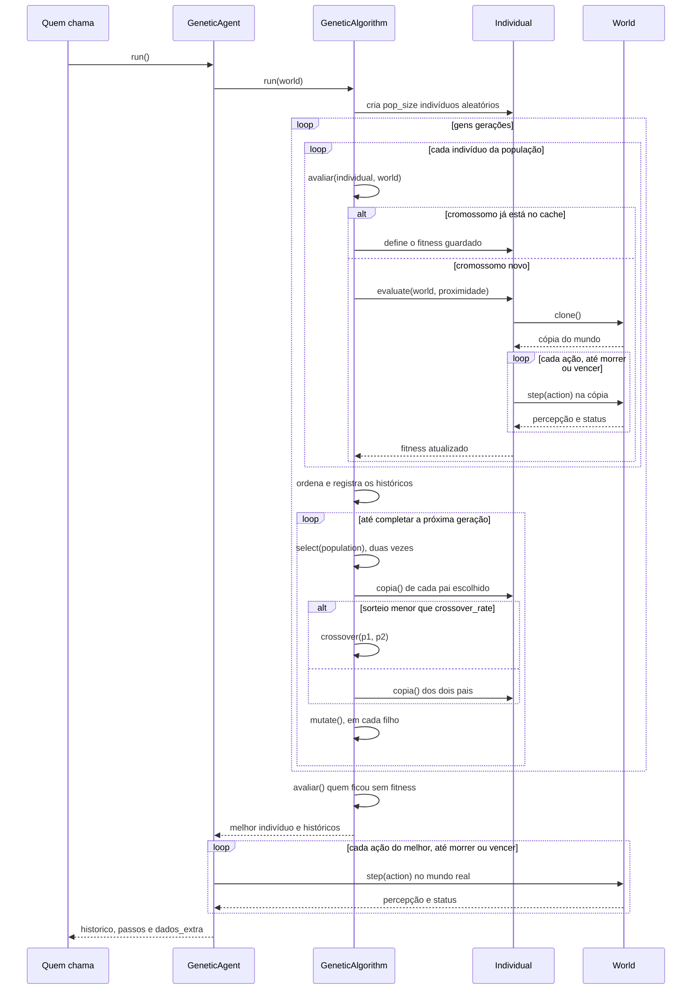

# Sequência de uma execução do algoritmo genético

Mostra a troca de mensagens entre as classes quando o agente genético roda uma vez. As regras de seleção, cruzamento, mutação e
fitness estão no [fluxograma do algoritmo genético](fluxo-ag.md).

## Observações

- **Quem chama** é `executar_uma`, nos benchmarks, ou `execucao_unica`, nas opções 3 e 4 do menu.
- Toda a evolução acontece em cópias criadas por `World.clone`. O mundo real só é alterado no final, ao executar o melhor
  indivíduo.
- Os `dados_extra` devolvidos alimentam os gráficos avançados e o arquivo `.npz` do run.
