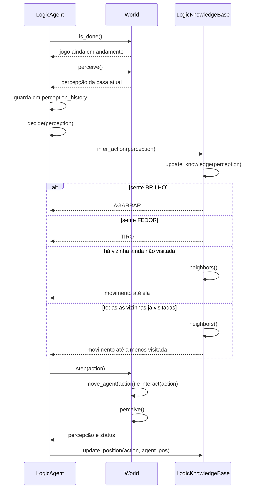

# Sequência de um passo do agente lógico

Mostra o que acontece em uma volta do laço de `LogicAgent.run`. O laço se repete até o jogo terminar ou até atingir `max_steps`,
que por padrão é 4 vezes o número de casas do mundo.

## Regras de decisão

`LogicKnowledgeBase.infer_action` testa as regras nesta ordem e usa a primeira que valer:

| Ordem | Condição | Ação |
|---|---|---|
| 1 | Sente `BRILHO` | `AGARRAR` |
| 2 | Sente `FEDOR` | `TIRO` |
| 3 | Existe vizinha ainda não visitada | Move para a primeira, na ordem cima, baixo, esquerda, direita |
| 4 | Todas as vizinhas já foram visitadas | Move para a menos visitada |

## Observações

- A base marca cada casa como `seguro` ou não, mas `infer_action` não consulta essa marca. A `BRISA` não muda a decisão, então
  o agente pode andar para um poço.
- A posição na base vem de `World.agent_pos`, para um movimento bloqueado pela parede não desencontrar a base do mundo.
- A percepção devolvida por `step` não é usada: a próxima volta do laço chama `perceive` de novo.

## Agente `logico_seguro`

`AgenteLogicoSeguro` usa este mesmo laço. Só muda `infer_action`, em `BaseConhecimentoSegura`. Para ela, uma casa é segura se
foi visitada ou se é vizinha de casa visitada sem `BRISA`.

| Ordem | Condição | Ação |
|---|---|---|
| 1 | Sente `BRILHO` | `AGARRAR` |
| 2 | Sente `FEDOR` | `TIRO` |
| 3 | Existe casa segura ainda não visitada | Anda até a mais próxima, passando só por casas visitadas |
| 4 | Nenhuma casa segura nova | Vai à casa da fronteira menos suspeita, descartando as que certamente têm poço; no empate, a de menor linha e coluna |
| 5 | Nada a explorar nem a arriscar | Circula pelas casas conhecidas, preferindo a menos visitada |

Os motivos e as medições estão na [investigação de 11/11/2026](../investigacao-agente-logico-2026-11.md).
