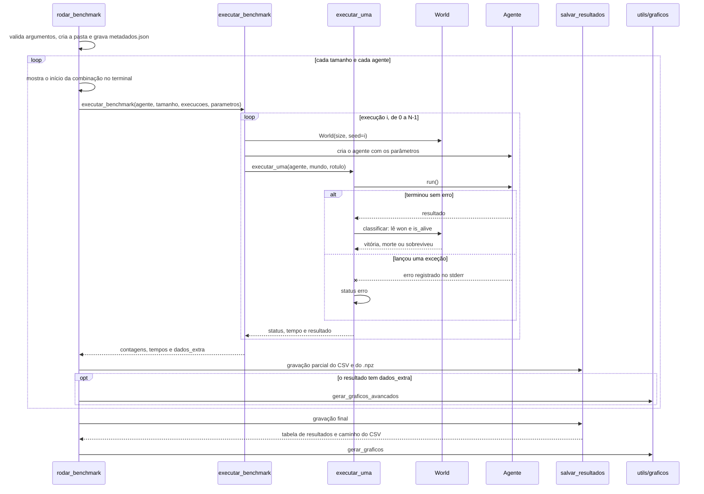

# Sequência de um benchmark completo

Mostra quem chama quem durante um benchmark com `benchmark.py`, que é o arquivo padrão. O caminho desde o menu está no
[fluxograma geral](fluxo-geral.md), e o que acontece dentro do agente genético está na
[sequência do algoritmo genético](sequencia-ag.md).

## Observações

- A semente do mundo é o número da execução, então as execuções podem ser repetidas com os mesmos mundos.
- `dados_extra` vem da primeira execução que terminou sem erro. Por isso os gráficos avançados mostram só essa execução
  ([#29](https://github.com/ingrid-kiki/wumpus_world_modular/issues/29)).
- Uma execução com erro entra na coluna `erros` e não conta como vitória, morte ou sobrevivência.
- Com `--paralelo`, as execuções rodam em processos paralelos, com `joblib`, na mesma lógica. Os erros voltam ao processo
  principal e são escritos no `saida_terminal.txt` depois das execuções.
- `tempo_total` é o tempo de relógio da combinação, e `tempo_medio` é a média do tempo de cada execução.
